# n8n-renewal-forecast-contract-expiration-radar

> Customer success pipeline that tracks enterprise contract expiration dates 90, 60, and 30 days out, automatically provisioning renewal deals and alerting account managers.

Every morning at 08:00 UTC the workflow pulls closed-won HubSpot deals whose contract ends within the radar horizon. It flags enterprise contracts that land exactly on a 90, 60 or 30-day milestone and checks whether each one already has a renewal deal. Where none exists, it prepares a HubSpot batch payload that creates one with the ARR, contract end date, renewal stage, company association and Account Manager already filled in. It then sends each Account Manager a Slack Block Kit summary of their expiring contracts and ARR at risk, and writes one audit record per run.

It is **safe by default**. Imported as-is, it reads a synthetic fixture, makes **zero network calls**, and creates nothing in HubSpot.

---

## Table of contents

1. [Architecture overview](#1-architecture-overview)
2. [Repository layout](#2-repository-layout)
3. [Prerequisites & HubSpot Private App scopes](#3-prerequisites--hubspot-private-app-scopes)
4. [5-minute sandbox quick start](#4-5-minute-sandbox-quick-start)
5. [Step-by-step import & configuration](#5-step-by-step-import--configuration)
6. [Environment variables](#6-environment-variables)
7. [Renewal forecasting logic](#7-renewal-forecasting-logic)
8. [Milestone window rules](#8-milestone-window-rules)
9. [Duplicate prevention](#9-duplicate-prevention)
10. [HubSpot payloads](#10-hubspot-payloads)
11. [Safety limits & guardrails](#11-safety-limits--guardrails)
12. [RevOps best practices](#12-revops-best-practices)
13. [Safety matrix](#13-safety-matrix)
14. [Data protection & compliance checklist](#14-data-protection--compliance-checklist)
15. [Troubleshooting](#15-troubleshooting)
16. [Disclaimer & license](#-disclaimer--liability-limitation)

---

## 1. Architecture overview

| Stage | Node(s) | Purpose |
|---|---|---|
| Triggers | `Daily 08:00 UTC Schedule`, `Manual Test Trigger` | Daily cron (`0 8 * * *`, workflow timezone UTC) or an on-demand test run |
| Config & safety gate | `Config & Safety Gate` | Reads every setting from `$env`: radar windows, pipeline and stage IDs, property mapping, guardrails and flags. Validates them and computes per-write permissions. Secrets never enter execution data |
| Data source router | `Sandbox Mode?` → `Load Mock Fixture` **or** the live HubSpot read chain | Synthetic HubSpot-shaped fixture in sandbox; read-only HubSpot API calls when live |
| Live HubSpot reads | `Search Expiring Deals` → `Search Existing Renewals` → `Prepare Association Batches` → `Has Deals To Enrich?` → `Read Deal-Company Associations` → `Prepare Company Batches` → `Read Companies` → `Get Active Owners` → `Normalize Live HubSpot Data` | Paginated searches, v4 association batch reads, company batch reads and active owners, reshaped to match the fixture format |
| Radar & provisioning engine | `Renewal Radar & Provisioning Engine` | Milestone detection, enterprise filter, owner mapping, four-layer duplicate prevention, ARR forecast, HubSpot batch payloads, circuit breaker |
| HubSpot writes | `Live Writes Allowed?` → `Split HubSpot Operations` → `HubSpot Batch Create / Update (Live)` → `Collect HubSpot Results` **or** `Dry-Run HubSpot Preview` | `batch/create` for renewal deals, `batch/update` for stage advances and milestone write-back |
| Alerts | `Build RevOps Alerts` → `Send Slack Alert?` → `Post Slack Alert` → `Send Webhook Alert?` → `Post Alert Webhook` | Slack Block Kit grouped by Account Manager, plus a JSON webhook event |
| Audit | `Execution Summary & Audit` | One structured audit record per run |

### Data flow

```mermaid
flowchart LR
    A1[Daily 08:00 UTC Schedule] --> B
    A2[Manual Test Trigger] --> B
    B[Config & Safety Gate<br/>windows · pipelines · stages · flags] --> C{Sandbox Mode?}
    C -- true --> D[Load Mock Fixture<br/>synthetic HubSpot data]
    C -- false --> E1[POST deals/search<br/>contracts ending ≤ 90d]
    E1 --> E2[POST deals/search<br/>existing renewal deals]
    E2 --> E3[Prepare Association Batches]
    E3 --> E4{Has Deals To Enrich?}
    E4 -- yes --> E5[v4 deal→company<br/>associations batch/read]
    E5 --> E6[companies batch/read]
    E6 --> E7[GET active owners]
    E7 --> N[Normalize Live HubSpot Data]
    E4 -- no --> N
    D --> F[Renewal Radar & Provisioning Engine<br/>milestones · enterprise filter · dedupe · forecast · circuit breaker]
    N --> F
    F --> G{Live Writes Allowed?}
    G -- true --> H1[Split HubSpot Operations<br/>second safety interlock]
    H1 --> H2[POST deals/batch/create<br/>POST deals/batch/update]
    H2 --> H3[Collect HubSpot Results]
    G -- false --> I[Dry-Run HubSpot Preview]
    H3 --> K[Build RevOps Alerts<br/>Block Kit by Account Manager]
    I --> K
    K --> L{Send Slack Alert?}
    L -- true --> M[Post Slack Alert]
    L -- false --> O{Send Webhook Alert?}
    M --> O
    O -- true --> P[Post Alert Webhook]
    O -- false --> Q[Execution Summary & Audit]
    P --> Q
```



---

## 2. Repository layout

```
n8n-renewal-forecast-contract-expiration-radar/
├── workflow.json                                   # Importable n8n workflow (30 nodes incl. 4 sticky notes)
├── README.md                                       # This file
├── DISCLAIMER.md                                   # Liability limitation
├── LICENSE                                         # MIT
├── .env.example                                    # Sample environment file (placeholders only)
├── .gitignore
├── sample-payloads/
│   └── hubspot-contract-expiration-fixture.json    # Synthetic HubSpot-shaped deals, companies, associations, owners
└── scripts/
    └── simulate-sandbox-run.js                     # Offline simulator: runs the Code nodes in plain Node.js
```

The fixture embedded in `Load Mock Fixture` is identical to `sample-payloads/hubspot-contract-expiration-fixture.json`. It uses the same shapes HubSpot returns (`results[].properties`, v4 association `from`/`to`, owner objects), so sandbox and live data go through the same engine code.

---

## 3. Prerequisites & HubSpot Private App scopes

| Requirement | Detail |
|---|---|
| n8n | Self-hosted n8n **1.x or 2.x** (Code node v2, IF node v2, HTTP Request node v4.2 with pagination, Schedule Trigger v1.2) |
| Env access | `N8N_BLOCK_ENV_ACCESS_IN_NODE=false` so Code nodes and expressions can read `$env`. If access is blocked, the gate falls back to sandbox and records why |
| n8n Cloud | Cloud does not expose custom environment variables. Use n8n Variables: find-and-replace `$env.` with `$vars.` in the workflow JSON |
| HubSpot | A **Private App** in the target portal (use a developer test account or sandbox account first) |
| Slack (optional) | An incoming webhook for the renewals or customer success channel |
| Node.js (optional) | Node 18+ to run `scripts/simulate-sandbox-run.js` |

### Required Private App scopes

| Scope | Used by | Why |
|---|---|---|
| `crm.objects.deals.read` | `Search Expiring Deals`, `Search Existing Renewals`, `Read Deal-Company Associations` | Find contracts and existing renewal deals; read deal associations |
| `crm.objects.deals.write` | `HubSpot Batch Create / Update` | Create renewal deals, advance renewal stages, write back the last milestone. Grant only when you are ready for live writes |
| `crm.objects.companies.read` | `Read Deal-Company Associations`, `Read Companies` | Company name and tier for the enterprise filter and deal names |
| `crm.objects.owners.read` | `Get Active Owners` | Check that the Account Manager is still active before assigning ownership |

Run Phases 1 and 2 (below) with a token that has the three `.read` scopes only. Add `crm.objects.deals.write` for Phase 3.

### Required HubSpot properties

Create these once in *Settings → Properties*. Every name can be remapped with environment variables.

| Object | Internal name | Type | Purpose |
|---|---|---|---|
| Deal | `contract_end_date` | Date picker | Contract expiration date on the closed-won (source) deal, copied to the renewal |
| Deal | `arr` | Number (currency) | Annual recurring revenue. Falls back to `amount` if empty |
| Deal | `renewal_source_deal_id` | Single-line text | Set on each renewal deal: the ID of the contract deal it renews |
| Deal | `renewal_idempotency_key` | Single-line text, **"Require unique values" on** | `renewal-<sourceDealId>-<contractEndDate>`. HubSpot itself then rejects a second deal with the same key |
| Deal | `renewal_radar_last_milestone` | Number | Last milestone alerted (90/60/30). Used only when `MILESTONE_WRITEBACK_ENABLED=true` |
| Company | `customer_tier` | Dropdown (e.g. Enterprise, Strategic, Mid-Market) | Enterprise filter |

You also need a **renewal pipeline**, with one stage per radar window (for example *Renewal Identified*, *Proposal*, *Commit*) plus closed won and closed lost stages. Copy the pipeline and stage **internal IDs** from *Settings → Objects → Deals → Pipelines*.

---

## 4. 5-minute sandbox quick start

1. **Import.** In n8n go to *Workflows → Import from File* and choose `workflow.json`.
2. **Leave every flag at its default.** No variables are needed for sandbox mode.
3. **Run it.** Open the workflow and click **Test workflow** (this fires `Manual Test Trigger`).
4. **Inspect the result.**
   - `Renewal Radar & Provisioning Engine` holds the full plan: each contract's status, milestone, duplicate check, the forecast, and the HubSpot `operations`.
   - `Dry-Run HubSpot Preview` holds each `would_send` batch request (URL and full body).
   - `Build RevOps Alerts → alerts.slackPayload` holds the Block Kit JSON. Paste it into [Slack Block Kit Builder](https://app.slack.com/block-kit-builder) to preview it.
   - `Execution Summary & Audit` holds the audit record.
5. **(Optional) Run offline, without n8n:**

   ```bash
   node scripts/simulate-sandbox-run.js                                   # audit record
   node scripts/simulate-sandbox-run.js --plan                            # full engine output
   node scripts/simulate-sandbox-run.js --slack                           # Slack Block Kit payload
   RADAR_REFERENCE_DATE=2026-12-16 node scripts/simulate-sandbox-run.js   # replay the radar 30 days later
   CIRCUIT_BREAKER_MAX_PROPOSED_DEALS=2 node scripts/simulate-sandbox-run.js   # trip the breaker
   ```

In sandbox, the radar date is pinned to the fixture's `as_of` (`2026-11-16`) so the demo gives the same result every day. `RADAR_REFERENCE_DATE` overrides it.

### Expected sandbox result (default rules)

| Source deal | Company (ID) | Ends | Days | ARR | Result |
|---|---|---|---|---|---|
| `66001` | Apex Global Tech (`55001`) | 2027-02-14 | 90 | $240,000 | **90-day milestone → renewal deal provisioned**, owner `70000001` |
| `66002` | Vanguard Enterprise (`55002`) | 2027-01-15 | 60 | $180,000 | **60-day milestone**; renewal `66102` exists (source ID match); stage advance to `880001-proposal` proposed |
| `66003` | Northwind Example Systems (`55003`) | 2026-12-16 | 30 | $420,000 | **30-day milestone → renewal provisioned**; original owner `70000003` is archived, so it goes to fallback owner `70000099` |
| `66004` | Orion Data Example Corp (`55004`) | 2027-02-13 | 89 | $95,000 | Not a milestone day → **backfill provisioning** (no renewal deal yet) |
| `66005` | Summit Example Holdings (`55005`) | 2027-01-15 | 60 | $30,000 | Skipped: Mid-Market tier and ARR below $50,000 |
| `66006` | Apex Global Tech (`55001`) | 2027-03-20 | 124 | $60,000 | Outside the radar |
| `66007` | Vanguard Enterprise (`55002`) | 2027-01-16 | 61 | $130,000 | Duplicate prevented: manually created open renewal `66107` on the same company, flagged for review |
| `66008` | Northwind Example Systems (`55003`) | 2027-02-14 | 90 | $150,000 | **90-day milestone**; renewal `66108` exists (idempotency key match) |
| `66009` | Orion Data Example Corp (`55004`) | `TBD` | — | $72,000 | Data quality issue: unparseable end date |

Totals: **$1,215,000** ARR in the radar, **$755,000** without a renewal deal yet, 3 renewal deals previewed, and 3 duplicates prevented. The run severity is **CRITICAL** because a $420,000 contract is 30 days out with no renewal deal.

---

## 5. Step-by-step import & configuration

### Phase 1 — Sandbox (no credentials)
Follow the quick start. Adjust the windows, enterprise rules and naming template, and replay different dates with `RADAR_REFERENCE_DATE` in the simulator.

### Phase 2 — Live reads, dry run (read-only token)
1. Create the custom properties and the renewal pipeline ([§3](#required-hubspot-properties)).
2. Create a Private App with the three `.read` scopes, then put its token in `HUBSPOT_ACCESS_TOKEN` in your secret manager or host environment.
3. Set the mapping explicitly: `HUBSPOT_PORTAL_ID`, `HUBSPOT_SOURCE_PIPELINE_ID`, `HUBSPOT_SOURCE_CLOSED_WON_STAGE_IDS`, `HUBSPOT_RENEWAL_PIPELINE_ID`, `HUBSPOT_RENEWAL_CLOSED_STAGE_IDS`, and `RENEWAL_STAGE_90_ID` / `_60_ID` / `_30_ID`.
4. Set `RENEWAL_FALLBACK_OWNER_ID` to a real, active owner (for example a renewals desk user).
5. Set `SANDBOX_MODE=false`. Keep `DRY_RUN=true`. Optionally set `SEND_SLACK_ALERTS=true` and `SLACK_RENEWAL_WEBHOOK_URL` to receive dry-run alerts.
6. Restart n8n, run manually, and compare `Normalize Live HubSpot Data` with what the HubSpot UI shows.
7. Activate the workflow and run it daily in dry-run mode for **2–4 weeks**. Check every proposed renewal against the contract.

> The gate stays in sandbox if `HUBSPOT_ACCESS_TOKEN` is missing or the base URL is not `https://`. It stays in dry run until the renewal pipeline, stage IDs and portal ID are set **explicitly**, because the mock defaults are never used for live writes. Every reason appears in `gate.reasons`.

### Phase 3 — Live writes
1. Add `crm.objects.deals.write` to the Private App.
2. Turn on **Require unique values** for `renewal_idempotency_key`.
3. Set `DRY_RUN=false` and `RENEWAL_DEALS_CREATION_ENABLED=true`. Start with `MAX_RENEWAL_DEALS_PER_RUN=5`.
4. Once creation looks right, optionally enable `MILESTONE_WRITEBACK_ENABLED=true` (turns on catch-up) and `RENEWAL_STAGE_UPDATES_ENABLED=true` (forward-only stage advances).
5. Review `Collect HubSpot Results` and the audit record after each run for the first two weeks.

### Rollback
Set `RENEWAL_DEALS_CREATION_ENABLED=false` (or `DRY_RUN=true`) to stop writes immediately. Every renewal deal the workflow created carries `renewal_source_deal_id` and `renewal_idempotency_key`, so you can find all of them with a HubSpot list filter on those properties. Each audit record also lists `created_renewal_deal_id` per contract.

---

## 6. Environment variables

### Safety flags

| Variable | Default | Description |
|---|---|---|
| `SANDBOX_MODE` | `true` | Use the embedded synthetic fixture. Blocks **all** network calls, including alerts |
| `DRY_RUN` | `true` | Read live HubSpot data but never write |
| `RENEWAL_DEALS_CREATION_ENABLED` | `false` | Allow `deals/batch/create` for new renewal deals |
| `RENEWAL_STAGE_UPDATES_ENABLED` | `false` | Allow forward-only stage advances on existing renewal deals |
| `MILESTONE_WRITEBACK_ENABLED` | `false` | Write the alerted milestone to the source deal. This also turns on catch-up windows |
| `SEND_SLACK_ALERTS` | `false` | Post the Block Kit alert (never in sandbox) |
| `SEND_WEBHOOK_ALERTS` | `false` | Post the JSON event (never in sandbox) |
| `ALERT_MIN_SEVERITY` | `WARNING` | `INFO`, `WARNING` or `CRITICAL` |
| `ALERT_MAX_ITEMS_PER_SECTION` | `10` | Maximum contracts listed per Account Manager in Slack |

Booleans accept `true/false/1/0/yes/no/on/off`. Any other value falls back to the safe default and is logged in `gate.warnings`.

### HubSpot connection & mapping

| Variable | Default (mock) | Secret | Description |
|---|---|---|---|
| `HUBSPOT_ACCESS_TOKEN` | — | ✅ | Private App token, read only inside HTTP node headers |
| `HUBSPOT_API_BASE_URL` | `https://api.hubapi.com` | | HubSpot API base URL |
| `HUBSPOT_PORTAL_ID` | `99000001` | | Portal ID, used for record links in Slack. **Required for live writes** |
| `HUBSPOT_SOURCE_PIPELINE_ID` | `default` | | Pipeline that holds the closed-won contract deals |
| `HUBSPOT_SOURCE_CLOSED_WON_STAGE_IDS` | `closedwon` | | Comma-separated closed-won stage IDs |
| `HUBSPOT_RENEWAL_PIPELINE_ID` | `880001` | | Renewal pipeline ID. **Required for live writes** |
| `RENEWAL_STAGE_90_ID` / `_60_ID` / `_30_ID` | `880001-identified` / `-proposal` / `-commit` | | Stage for each window. **Required for live writes.** Add `RENEWAL_STAGE_<N>_ID` for any custom window |
| `HUBSPOT_RENEWAL_CLOSED_STAGE_IDS` | `880001-won,880001-lost` | | Closed renewal stages are never modified and never count as duplicates |
| `HUBSPOT_DEAL_COMPANY_ASSOCIATION_TYPE_ID` | `5` | | Deal → company association type (5 = primary company) |
| `HUBSPOT_MAX_SEARCH_PAGES` | `50` | | Recorded page limit for searches (the HTTP nodes cap at 50 pages × 100 records) |
| `HUBSPOT_BATCH_SIZE` | `100` | | Records per batch request (HubSpot maximum: 100) |
| `HUBSPOT_CONTRACT_END_DATE_PROPERTY` | `contract_end_date` | | Contract end date property |
| `HUBSPOT_ARR_PROPERTY` | `arr` | | ARR property (falls back to `amount`) |
| `HUBSPOT_RENEWAL_SOURCE_PROPERTY` | `renewal_source_deal_id` | | Renewal → source deal link |
| `HUBSPOT_RENEWAL_KEY_PROPERTY` | `renewal_idempotency_key` | | Idempotency key property |
| `HUBSPOT_LAST_MILESTONE_PROPERTY` | `renewal_radar_last_milestone` | | Milestone write-back property |
| `HUBSPOT_COMPANY_TIER_PROPERTY` | `customer_tier` | | Company tier property |

### Radar rules & guardrails

| Variable | Default | Description |
|---|---|---|
| `RENEWAL_WINDOWS_DAYS` | `90,60,30` | Milestone windows in days. The largest one is also the provisioning horizon |
| `WINDOW_CATCHUP_DAYS` | `2` | Days after a missed milestone during which it still fires. Effective only when write-back is enabled |
| `RADAR_REFERENCE_DATE` | *(today, UTC)* | `YYYY-MM-DD` override for replays and testing |
| `ENTERPRISE_MIN_ARR` | `50000` | ARR at or above this counts as enterprise |
| `ENTERPRISE_TIER_VALUES` | `Enterprise,Strategic` | Company tier values that count as enterprise (case-insensitive) |
| `RENEWAL_MATCH_TOLERANCE_DAYS` | `45` | Association-match window between an existing renewal's close date and the contract end date |
| `RENEWAL_UPLIFT_PCT` | `0` | Uplift applied to ARR for the renewal `amount` (e.g. `7` for a 7% price increase) |
| `RENEWAL_DEAL_NAME_TEMPLATE` | `{company_name} - Renewal {contract_end_year}` | Tokens: `{company_name}`, `{source_deal_name}`, `{contract_end_date}`, `{contract_end_year}` |
| `RENEWAL_CURRENCY` | `USD` | Currency format in alerts |
| `RENEWAL_FALLBACK_OWNER_ID` | `70000099` | Owner for renewals whose Account Manager is missing or inactive |
| `MAX_RENEWAL_DEALS_PER_RUN` | `25` | Cap on creates per run, most urgent first; the rest are deferred |
| `CIRCUIT_BREAKER_MAX_PROPOSED_DEALS` | `75` | Freezes all writes if more renewals than this are proposed in one run |
| `CIRCUIT_BREAKER_INVALID_DATE_PCT` | `20` | Freezes all writes if at least this share of contracts has an invalid end date (minimum 5 contracts) |
| `SLACK_RENEWAL_WEBHOOK_URL` | — | ✅ Slack incoming webhook |
| `ALERT_WEBHOOK_URL` | — | ✅ Generic JSON webhook endpoint |

### Sample `.env`

The same content is in `.env.example`.

```dotenv
# n8n runtime
N8N_BLOCK_ENV_ACCESS_IN_NODE=false
GENERIC_TIMEZONE=UTC

# Safety flags (safe defaults)
SANDBOX_MODE=true
DRY_RUN=true
RENEWAL_DEALS_CREATION_ENABLED=false
RENEWAL_STAGE_UPDATES_ENABLED=false
MILESTONE_WRITEBACK_ENABLED=false
SEND_SLACK_ALERTS=false
SEND_WEBHOOK_ALERTS=false
ALERT_MIN_SEVERITY=WARNING

# HubSpot — secrets belong in your secret manager
HUBSPOT_ACCESS_TOKEN=
HUBSPOT_API_BASE_URL=https://api.hubapi.com
HUBSPOT_PORTAL_ID=99000001
HUBSPOT_SOURCE_PIPELINE_ID=default
HUBSPOT_SOURCE_CLOSED_WON_STAGE_IDS=closedwon
HUBSPOT_RENEWAL_PIPELINE_ID=880001
HUBSPOT_RENEWAL_CLOSED_STAGE_IDS=880001-won,880001-lost
RENEWAL_STAGE_90_ID=880001-identified
RENEWAL_STAGE_60_ID=880001-proposal
RENEWAL_STAGE_30_ID=880001-commit

# Radar rules
RENEWAL_WINDOWS_DAYS=90,60,30
WINDOW_CATCHUP_DAYS=2
ENTERPRISE_MIN_ARR=50000
ENTERPRISE_TIER_VALUES=Enterprise,Strategic
RENEWAL_FALLBACK_OWNER_ID=70000099
MAX_RENEWAL_DEALS_PER_RUN=25
CIRCUIT_BREAKER_MAX_PROPOSED_DEALS=75

# Alerts — secrets
SLACK_RENEWAL_WEBHOOK_URL=
ALERT_WEBHOOK_URL=
```

---

## 7. Renewal forecasting logic

1. **Scope.** The search covers deals in `HUBSPOT_SOURCE_PIPELINE_ID`, in a closed-won stage, whose `contract_end_date` falls between the radar date and the radar date + 91 days.
2. **Enterprise filter.** A contract counts as enterprise if its primary company's `customer_tier` is in `ENTERPRISE_TIER_VALUES`, **or** its ARR is at least `ENTERPRISE_MIN_ARR`.
3. **Days until expiration.** Whole UTC days between the radar date and the contract end date. Date values in `YYYY-MM-DD`, ISO date-time, and epoch-milliseconds form are all accepted. Anything else is reported as a data quality issue.
4. **Forecast buckets.** Every enterprise contract inside the horizon falls into its tightest window (≤30, ≤60 or ≤90 days). For each bucket the engine reports contract count, **ARR at risk**, and how many contracts still have no renewal deal.
5. **Renewal amount.** ARR × (1 + `RENEWAL_UPLIFT_PCT` / 100). The original ARR is also copied to the renewal's `arr` property.
6. **Ownership.** The renewal goes to the source deal's `hubspot_owner_id`. If that owner is missing, archived, or not in the active owners list, it goes to `RENEWAL_FALLBACK_OWNER_ID`. If the fallback owner is also inactive, the deal is left unassigned and flagged.

### Contract statuses

| Status | Meaning |
|---|---|
| `PROVISION` | Enterprise contract in the horizon with no renewal deal; a create payload is built |
| `RENEWAL_EXISTS` | A renewal deal already exists (see [§9](#9-duplicate-prevention)); only a stage advance may be proposed |
| `DEFERRED_RATE_LIMIT` | Beyond `MAX_RENEWAL_DEALS_PER_RUN`; it will be created on a later run |
| `BLOCKED_CIRCUIT_BREAKER` | The breaker tripped; nothing was created |
| `SKIPPED_NOT_ENTERPRISE` | Below both the tier and the ARR thresholds |
| `OUTSIDE_RADAR` / `EXPIRED` | Beyond the horizon, or already past its end date |
| `DATA_QUALITY_INVALID_DATE` | The end date could not be parsed |
| `SKIPPED_NOT_CLOSED_WON` | Not in the source pipeline or not in a closed-won stage |

---

## 8. Milestone window rules

| Rule | Behavior |
|---|---|
| **Exact milestone** | A contract hits window *W* when `days_until_expiration == W` (90, 60 or 30 by default). This drives Account Manager alerts |
| **Catch-up** | With `MILESTONE_WRITEBACK_ENABLED=true`, a milestone also fires for `W − WINDOW_CATCHUP_DAYS ≤ days ≤ W`, as long as `renewal_radar_last_milestone` is empty or greater than *W*. This covers missed daily runs |
| **No repeats** | Without write-back, catch-up is forced to 0 so each milestone fires on exactly one day. With write-back, the stored milestone stops repeats |
| **Provisioning is horizon-based** | A renewal deal is created for **any** enterprise contract inside the horizon (≤90d) that has none, even on a non-milestone day (`provision_reason: Backfill`). A contract added late, or a create that failed earlier, is picked up on the next run |
| **Stage by window** | New renewals start in the stage of the tightest window that applies (≤30d → `RENEWAL_STAGE_30_ID`, and so on) |
| **Forward-only stage advance** | With `RENEWAL_STAGE_UPDATES_ENABLED=true`, an existing renewal is moved to the window's stage only if (a) its current stage is one of the mapped stages, (b) the target stage is later, and (c) it is not closed. Custom or manually set stages are never touched |
| **Custom windows** | e.g. `RENEWAL_WINDOWS_DAYS=120,90,60,30` together with `RENEWAL_STAGE_120_ID=...` |

---

## 9. Duplicate prevention

Before any create payload is built, four checks run in order. The first match wins.

| # | Check | Match | Result |
|---|---|---|---|
| 1 | **Source link** | A renewal deal in the renewal pipeline with `renewal_source_deal_id` = the source deal ID | `RENEWAL_EXISTS` |
| 2 | **Idempotency key** | A renewal deal with `renewal_idempotency_key` = `renewal-<sourceDealId>-<contractEndDate>` | `RENEWAL_EXISTS` |
| 3 | **Company association** | An **open** renewal deal associated with the same company, not already linked to another contract, whose contract end or close date is within `RENEWAL_MATCH_TOLERANCE_DAYS` | `RENEWAL_EXISTS`, plus a note asking someone to set `renewal_source_deal_id` on it |
| 4 | **In-run dedupe** | The same idempotency key twice in one run | Second one skipped |

Two more protections sit outside the engine:
- **Database-level.** With "Require unique values" on `renewal_idempotency_key`, HubSpot itself rejects a second deal with the same key, even if two runs overlap.
- **No automatic retry on writes.** `HubSpot Batch Create / Update (Live)` does not retry, because a create whose response was lost could otherwise run twice. Failed batches show up in the alert and the audit record, and the next run's backfill retries them safely through checks 1–2.

---

## 10. HubSpot payloads

**Create renewal deals:** `POST /crm/v3/objects/deals/batch/create` (up to 100 inputs per request)

```json
{
  "inputs": [
    {
      "properties": {
        "dealname": "Apex Global Tech - Renewal 2027",
        "pipeline": "880001",
        "dealstage": "880001-identified",
        "closedate": "2027-02-14T00:00:00.000Z",
        "contract_end_date": "2027-02-14",
        "renewal_source_deal_id": "66001",
        "renewal_idempotency_key": "renewal-66001-2027-02-14",
        "amount": "240000",
        "arr": "240000",
        "hubspot_owner_id": "70000001"
      },
      "associations": [
        { "to": { "id": "55001" }, "types": [ { "associationCategory": "HUBSPOT_DEFINED", "associationTypeId": 5 } ] }
      ]
    }
  ]
}
```

**Advance renewal stages:** `POST /crm/v3/objects/deals/batch/update`

```json
{ "inputs": [ { "id": "66102", "properties": { "dealstage": "880001-proposal" } } ] }
```

**Milestone write-back:** `POST /crm/v3/objects/deals/batch/update`

```json
{ "inputs": [ { "id": "66001", "properties": { "renewal_radar_last_milestone": "90" } } ] }
```

Requests are sent in order (creates, then stage updates, then write-back), one per second. `Collect HubSpot Results` handles `201`, `207` (partial success: created IDs are mapped back through `renewal_idempotency_key`) and error responses.

---

## 11. Safety limits & guardrails

| Guardrail | Default | Behavior |
|---|---|---|
| Explicit mapping for writes | always on | Live writes stay off until the portal, renewal pipeline and stage IDs are set explicitly; mock defaults never reach production |
| Separate write permissions | all off | Create, stage update and write-back each have their own flag |
| Per-run create cap | 25 | Most urgent contracts first (fewest days, then highest ARR); the rest are `DEFERRED_RATE_LIMIT` |
| **Circuit breaker: volume** | > 75 proposed creates | Freezes **all** writes. Usually means a wrong date property or pipeline mapping |
| **Circuit breaker: data quality** | ≥ 20% invalid end dates (min 5 contracts) | Freezes all writes |
| Search failure | always on | Any failed HubSpot search halts the run before any decision |
| Owner safety | always on | Only active owners are assigned; otherwise the fallback is used, or the deal is left unassigned and flagged |
| Stage safety | always on | Forward-only, mapped stages only, never on closed deals |
| Double interlock | always on | `Split HubSpot Operations` re-checks every flag and throws if any disagree |
| Rate limiting | searches 250 ms apart; writes 1 s apart | HubSpot search endpoints have a lower per-second limit than other CRM endpoints; check your portal's limits |
| Idempotency | per contract × end date | Engine checks plus an optional HubSpot unique-value property |

---

## 12. RevOps best practices

- **Treat `contract_end_date` as a governed field.** Make it required on closed-won deals in your pipeline rules, and audit it every quarter. The radar is only as good as this one date.
- **Track notice periods separately.** Many enterprise agreements require notice 60–90 days before the end date. If yours do, add a window that covers the notice deadline (for example `RENEWAL_WINDOWS_DAYS=120,90,60,30`).
- **One renewal deal per contract.** Ask Account Managers to set `renewal_source_deal_id` on any renewal they create by hand. The association-match check catches most manual deals, but the explicit link is more reliable.
- **Use a renewals desk owner as the fallback.** Departures and territory changes leave orphaned renewals; a fallback owner makes sure someone sees them.
- **Forecast in its own pipeline.** Keep renewals out of the new-business pipeline so new ARR and renewal ARR are reported separately.
- **Review the "ARR without a renewal deal" number weekly.** It should trend to zero inside the 60-day window.
- **Keep stage updates off at first.** Let Account Managers own stage movement until the team trusts the radar; then enable forward-only advances.
- **Write back milestones once creation is stable.** It turns on catch-up, so a missed run never means a missed milestone.

---

## 13. Safety matrix

| `SANDBOX_MODE` | `DRY_RUN` | Creation flag | Mapping explicit | Data source | HubSpot reads | Renewal deals created | Stage updates / write-back | Slack / webhook | Gate mode |
|---|---|---|---|---|---|---|---|---|---|
| `true` *(default)* | any | any | any | Mock fixture | ❌ | ❌ | ❌ | ❌ blocked | `SANDBOX` |
| `false` | `true` | any | any | Live HubSpot | ✅ | ❌ preview | ❌ preview | ✅ if enabled | `DRY_RUN` |
| `false` | `false` | `false` | ✅ | Live HubSpot | ✅ | ❌ preview | per own flag | ✅ if enabled | `LIVE` / `DRY_RUN` |
| `false` | `false` | `true` | ❌ | Live HubSpot | ✅ | ❌ preview | ❌ | ✅ if enabled | `DRY_RUN` |
| `false` | `false` | `true` | ✅ | Live HubSpot | ✅ | ✅ unless breaker tripped | per own flag | ✅ if enabled | `LIVE` |
| `false`, no token | any | any | any | Mock fixture (forced) | ❌ | ❌ | ❌ | ❌ | `SANDBOX` (forced) |
| env access blocked | any | any | any | Mock fixture (forced) | ❌ | ❌ | ❌ | ❌ | `SANDBOX` (forced) |

---

## 14. Data protection & compliance checklist

- [ ] `HUBSPOT_ACCESS_TOKEN`, `SLACK_RENEWAL_WEBHOOK_URL` and `ALERT_WEBHOOK_URL` live in environment variables or a secret manager, never in the workflow JSON, git, or screenshots.
- [ ] `.env` is git-ignored; only `.env.example` with blank secrets is committed.
- [ ] Secrets are read only inside HTTP node expressions. The gate outputs `secretsPresent` booleans, so they never appear in execution data.
- [ ] The Private App has only the four scopes in [§3](#required-private-app-scopes), and `crm.objects.deals.write` only from Phase 3.
- [ ] Alerts contain deal and company IDs, company names, Account Manager names, dates and ARR only: no contact names, contact emails or contract text. Owner emails are dropped during normalization.
- [ ] The Slack channel's membership matches who is allowed to see revenue and renewal data.
- [ ] n8n execution-data retention (`EXECUTIONS_DATA_MAX_AGE`, `EXECUTIONS_DATA_PRUNE`) matches your retention policy, since executions hold ARR and company data.
- [ ] Access to the n8n instance and this workflow is limited to RevOps and CS operations owners.
- [ ] The HubSpot data you process is covered by your customer agreements and privacy notices (GDPR / CCPA).
- [ ] Every automatically created renewal deal is reviewed by its owner, and the contract's notice and auto-renewal terms are checked against the signed agreement.
- [ ] The rollback steps in [§5](#rollback) have been tested in a sandbox portal.
- [ ] Fixtures and test runs use only synthetic data (portal `99000001`, companies `55001`–`55005`, `@example.com` domains).

---

## 15. Troubleshooting

| Symptom | Cause | Fix |
|---|---|---|
| Always `SANDBOX` | Token missing, or env access blocked | Check `gate.reasons`; set `N8N_BLOCK_ENV_ACCESS_IN_NODE=false` and restart n8n |
| `DRY_RUN` even with all flags on | Mapping still uses mock defaults | Set `HUBSPOT_PORTAL_ID`, `HUBSPOT_RENEWAL_PIPELINE_ID` and every `RENEWAL_STAGE_<window>_ID` |
| Search returns no deals | Wrong pipeline, stage or date property name, or the property is not a date | Check `config.live.searchExpiringBody` against your portal |
| `400` on batch create | Property missing in the portal, or a stage ID not in the renewal pipeline | Create the properties in [§3](#required-hubspot-properties); check the stage IDs |
| `409` / "value already exists" on create | The unique `renewal_idempotency_key` is doing its job: the renewal already exists | No action needed; it will match through check 2 on the next run |
| Every contract shows `SKIPPED_NOT_ENTERPRISE` | Tier values or the ARR property don't match | Set `ENTERPRISE_TIER_VALUES` / `HUBSPOT_ARR_PROPERTY` |
| A milestone was missed after n8n downtime | Write-back is off, so catch-up is off (exact-day only) | Enable `MILESTONE_WRITEBACK_ENABLED` and create `renewal_radar_last_milestone`. Provisioning still backfills missing renewal deals either way |
| `Safety interlock` error | The write branch ran without full authorization (e.g. the JSON was edited by hand) | Investigate the edit. No requests were sent |

---

## ⚠️ Disclaimer & Liability Limitation

**Use at your own risk.** The code, workflows, and scripts in this repository (`n8n-renewal-forecast-contract-expiration-radar`) are provided for educational and architectural demonstration purposes.

**No Liability:** The author and dhRobin Systems accept no responsibility or liability for any direct, indirect, incidental, or consequential damages that result from using, misusing, or deploying these scripts, including missed renewals, inaccurate forecasts, duplicate or missing renewal deals, or incorrectly changed CRM records.

**No Warranty:** All software, n8n JSON blueprints, JavaScript modules, milestone rules and forecast calculations are provided "AS IS", without warranty of any kind, express or implied. This includes, but is not limited to, warranties of merchantability, fitness for a particular purpose, and non-infringement.

**Production Testing Required:** Always test thoroughly in an isolated staging environment, such as a HubSpot developer test account or sandbox account, with `SANDBOX_MODE=true`, `DRY_RUN=true` and `RENEWAL_DEALS_CREATION_ENABLED=false` enabled, before you connect live HubSpot credentials or Slack webhooks. Treat every provisioned renewal deal and alert as a draft that a person must review, and confirm renewal and notice deadlines against the signed contract.

**Third-Party APIs & Compliance:** You alone are responsible for complying with the terms of service, rate limits, data privacy regulations (GDPR/CCPA), and security policies of HubSpot, Slack, n8n and any connected services. That includes protecting your private app token and webhook URLs, limiting scopes, keeping personal data out of alerts and logs, and reviewing every automatically created or updated record.

The full disclaimer is also available in `DISCLAIMER.md`.

## License

Released under the MIT License. Copyright (c) 2026 DH Robin (dhRobin Systems). See `LICENSE`.

---

Full text: DISCLAIMER.md · Licensed under the MIT License. License: MIT © 2026 DH Robin (dhRobin Systems) · Provided as-is, see the disclaimer.
